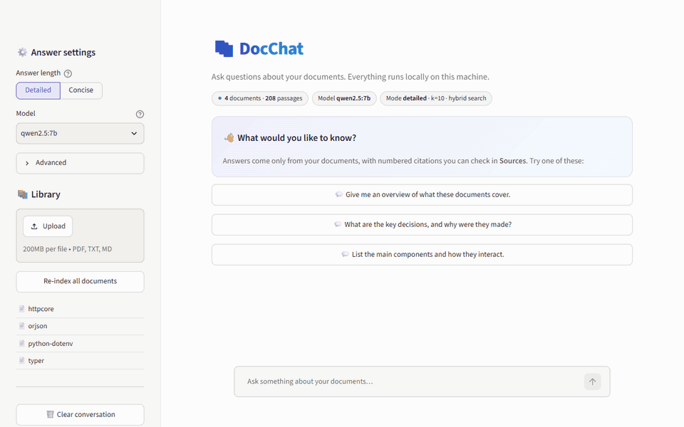

# 📚 Local RAG Assistant

[](https://github.com/youssefmohammedex-code/local-rag-assistant/actions/workflows/tests.yml)

Ask questions about your own documents (PDF, Markdown, text) and get cited answers, **100% offline**.
Everything runs on a laptop CPU: local embeddings and a local LLM through [Ollama](https://ollama.com), a [Chroma](https://www.trychroma.com) vector store, and a Streamlit chat UI. No API keys, no cloud and no cost.

Every design decision is backed by a measurement, usually on question sets written before the code was tuned and on documents it was never tuned on. The full story, including what didn't work, is in **[docs/EVALUATION.md](docs/EVALUATION.md)**.



*A question answered from httpcore's PDF documentation: every claim cites a passage, the citation check passes, and the cited passage is highlighted in Sources. The generation part is sped up; the real answer took 95 s on a laptop CPU.*

## Highlights

- **Hybrid search:** embeddings plus a from-scratch BM25 with identifier and heading boosting, merged with Reciprocal Rank Fusion. Embeddings alone can't tell "decision D13" from "D21".
- **Complete answers to "list every X" questions:**
  - **List expansion:** retrieval adds one passage per sub-section of the section being listed. Top-k alone clusters on a few items.
  - **List chooser:** the model picks which of two candidate lists the question means. It's asked in both orders to cancel position bias, falls back to naming the list's heading when its letters disagree, and declines to choose when still unsure.
  - **Answer outline:** the answer is written against an outline, so the model can't silently skip items.
- **Answers you can check:**
  - **Citation checker:** every cited sentence is matched against the passage it cites. Wrong passage ids, invented sentences and facts moved between sections are flagged in the UI.
  - **Filler repair:** sections the model leaves empty ("No specific versions mentioned"), skips or copies from another item are regenerated from their own passages.
  - **Very long lists:** items that don't fit in the context are named in a closing note, so the answer doesn't look complete when it isn't.
  - **Loop detection:** answers that start repeating are stopped.
- **Real-world documents:** PDF headings recovered from font size and weight; running headers and footers removed; heading-aware Markdown chunks; encoding, BOM, front-matter and other file quirks handled.
- **Reproducible benchmarks:** one command per document set reruns the list benchmark with identical answers (fixed seed, temperature 0, no cached prompts). There are 165 tests, and they run on GitHub Actions without Ollama.

## Results at a glance

| What was measured | Result |
|---|---|
| Passage retrieval, 20 held-out questions on private docs (hit@4) | vector 70% → **hybrid 100%** |
| Passage retrieval, 30 blind questions on third-party docs (hit@4) | vector 80% → **hybrid 87%** |
| Retrieved coverage of list items, 29 list questions over 4 document sets | 68% → **97%** with list expansion |
| Whole-changelog lists (35–48 releases) | retrieved coverage over 41 list questions 87% → **96%**; 3 changelogs answered at **100%** coverage, with details for every release that fits and the rest named in a note |
| List answers, reproducible benchmark (12 public questions, 7 held out) | **12 of 12 at 100%** coverage (one was at 67% until a chooser fix) |
| End-to-end answers on documents never tuned on (13 answerable, 3 unanswerable) | 11 correct with citations, **0 made up**, 3 of 3 refused |
| Citation checker on answers not used to build it | **22 of 24** flags are real errors |
| Filler repair on 3 answers never used to build it | **102 of 102** empty sections filled, all citations checked |
| Loop detector, replayed on 124 saved answers | stopped the 3 runaways, **0** of 121 normal answers |

Everything runs on a Ryzen 7 4750U laptop with 16 GB RAM and no GPU.

## Known limits

- **Speed:** qwen2.5:7b writes about 3–4 tokens/s on a laptop CPU. A long list answer takes 3–5 minutes, and repairing a 45-item list with filler adds about 15.
- **Very long lists only get details for what fits:** about 30 releases fit in the context budget for retrieved passages. The rest are named in a closing note from the document's headings, without details.
- **The list chooser sometimes can't decide:** in 2 of 16 unseen list questions it keeps both candidate lists, so the answer can include unrelated sections. On whole-changelog questions it stays undecided on 5 of 12 phrasings, all nested lists (the changelog and one release's sub-list). Then the closing note and the repair of skipped sections don't run.
- **The citation checker uses word overlap, not meaning:** a sentence that reuses a passage's words but reverses its meaning would pass.
- **Items written inside a section's text,** such as FAQ questions as bold lines, benefit less from list handling than items that are headings.
- **Small question sets:** 12–30 questions per benchmark, hand-graded where it matters. Treat the numbers as evidence, not guarantees.

## Architecture

```
            ┌────────────── ingest ──────────────┐
 data/docs ─► load (pypdf) ─► chunk ─► embed ─► Chroma
                                     (nomic-embed-text)
                                                   │
 question ─► embed query ─► top-k similarity search┘
                                   │
                    numbered context + question
                                   ▼
                     LLM (qwen2.5:7b via Ollama)
                                   ▼
                     answer with [n] citations
```

| Component | Choice | Why |
|---|---|---|
| Embeddings | `nomic-embed-text` (137M params) | Strong retrieval quality, fast on CPU, uses task prefixes |
| Vector store | Chroma (persistent, cosine) | Zero setup, stores metadata for citations |
| Hybrid search | Embeddings + BM25 keyword search (Snowball-stemmed), merged with Reciprocal Rank Fusion | Embeddings blur exact IDs ("D13" vs "D21"); keywords catch them. BM25 is written from scratch with identifier boosting and heading boosting |
| PDF structure | Headings detected from font size/weight, running headers/footers removed, sections that continue across pages | PDF text has no markup, so without this PDF passages had no headings and were cited only by page |
| Tiny sections | A section under 400 characters ("Requirements: Python 3.8+") borrows the following text for context but keeps its own heading | A 20-character passage is a weak match next to longer passages that mention the same words |
| LLM | `qwen2.5:7b` (swappable; `llama3.2:3b` for speed) | Most accurate in the model comparison below; fits in 16 GB RAM without a GPU |
| Chunking | Custom boundary-aware sliding window | Cuts at paragraph, sentence or word boundaries, with overlap |
| Markdown structure | Heading-aware sections + contextual headers | Each chunk is prefixed with its heading path (e.g. `Guide > 7. Modules > Module C`), so a passage keeps its meaning after it is cut out |
| List questions | Additive section expansion: *"describe every module"* keeps the normal top-k and adds one passage per sub-section, within a ~20k-character budget | Top-k similarity returns the k most similar passages, which cluster on a few items, so it can't answer "every X" |
| Answer modes | **Detailed** (k=10, structured Markdown) / **Concise** (k=4, 1–3 sentences) | Broad questions ("describe every module…") need more context and room to answer |
| Context window | `num_ctx=8192` | Ollama's default is too small for 10 passages plus a long answer |
| UI | Streamlit "DocChat": streaming answers, citation badges, source cards with match scores, document upload, model picker | |

**Example of the impact:** for *"Describe every module, who owns it, and what it is responsible for"* over a 110 KB set of architecture docs, the first version gave a 79-word answer covering 3 of 9 modules. With heading-aware chunks, Detailed mode and the larger context window, it gave 559 words covering all 9 modules and their owners.

## Quickstart

**1. Install Ollama** from <https://ollama.com/download> and pull the models:

```bash
ollama pull nomic-embed-text
ollama pull qwen2.5:7b        # default (4.7 GB)
ollama pull llama3.2:3b       # optional: ~2.5x faster, less accurate (2.0 GB)
```

**2. Set up Python (3.10+):**

```bash
python -m venv .venv
.venv\Scripts\activate        # Windows  (macOS/Linux: source .venv/bin/activate)
pip install -r requirements.txt
```

**3. Add documents** to `data/docs/` (a sample handbook is included), then index them:

```bash
python -m rag ingest
```

**4. Ask questions:**

```bash
python -m rag ask "What GPA do I need for the Dean's Honor List?"            # detailed answer
python -m rag ask --mode concise "How much does late registration cost?"
python -m rag ask --retrieval vector "..."   # compare against meaning-only search
streamlit run app.py          # or use the DocChat UI (upload files, pick model and answer length)
```

## Evaluation

Retrieval metrics (hit@k, MRR, latency, optional LLM-judged faithfulness) and the end-to-end list-answer benchmark:

```bash
python -m eval.run_eval              # retrieval metrics on the sample documents
python -m eval.run_eval --judge      # plus answer quality (slower)
python -m eval.list_answers --help   # reproducible list-answer benchmark
```

Results, method and every finding: **[docs/EVALUATION.md](docs/EVALUATION.md)**.

## Configuration

Set these as environment variables, or pass the CLI flags `--chunk-size`, `--chunk-overlap`, `-k`, `--model`, `--mode`, `--retrieval` and `--list-answers`:

| Variable | Default |
|---|---|
| `RAG_LLM_MODEL` | `qwen2.5:7b` |
| `RAG_EMBED_MODEL` | `nomic-embed-text` |
| `RAG_CHUNK_SIZE` / `RAG_CHUNK_OVERLAP` | `1000` / `150` (best config in the eval) |
| `RAG_ANSWER_MODE` | `detailed` (or `concise`) |
| `RAG_RETRIEVAL` | `hybrid` (or `vector`) |
| `RAG_EXPAND_LISTS` / `RAG_LIST_CHAR_BUDGET` | `1` / `20000` (set `0` to disable list expansion) |
| `RAG_LIST_ANSWERS` | `checklist` (or `single`, `per-item`; see [list answers](docs/EVALUATION.md#long-list-answers-helping-the-7b-model-not-skip-items)) |
| `RAG_TOP_K` | per mode: `10` detailed, `4` concise |
| `RAG_NUM_CTX` | `8192` |
| `RAG_MAX_ANSWER_TOKENS` | `3000` (stops a model stuck repeating itself; see "Reliability") |
| `RAG_SEED` | unset (random); set an integer, with temperature 0, for reproducible answers |
| `RAG_COLD_CALLS` | `0`; `1` unloads the model after every call so answers repeat exactly (slow, for benchmarks) |
| `RAG_DOCS_DIR` | `data/docs` |

## Project structure

```
rag/
  config.py      settings (env-overridable)
  loaders.py     PDF / Markdown / text loading
  chunking.py    boundary-aware overlapping chunker
  store.py       Chroma + Ollama embeddings
  pipeline.py    retrieve → prompt → generate
  loops.py       stops an answer once the model starts repeating itself
  citations.py   checks each cited sentence against the passages it cites
  filler.py      finds the filler sections of a list answer (regenerated by the pipeline)
  cli.py         `python -m rag ingest | ask`
app.py           Streamlit chat UI
eval/            question sets, benchmarks and results
docs/            EVALUATION.md: measurements and findings
.github/         CI: tests and lint on every push
tests/           unit tests (pytest, no Ollama needed)
```

## Reliability

- **Re-indexing is safe:** all embeddings are computed before the old index is replaced. If Ollama is down mid-way, or the docs folder is empty or misconfigured, the existing index is kept. This was a real bug found by testing failure cases: a failed re-index used to wipe the index.
- **Nothing fails silently:** files with no extractable text (empty files, corrupt PDFs, scanned PDFs that need OCR) and unsupported files (.docx, .html, …) are reported, and replacing an uploaded file is announced.
- **Real-world file quirks:** an edge-case audit of 23 crafted files found and fixed:
  - Windows-1252 text that was silently losing every accented letter and smart quote
  - setext headings (`Title` + `===`) that weren't recognized
  - UTF-8 BOMs that hid the first heading
  - YAML front matter that was indexed as content
  - Office lock files (`~$x.md`) and hidden folders (`.obsidian/`) that were indexed

  The fixes were checked to leave every existing document's output unchanged.
- **Answers can't run forever:** answers are capped at 3,000 tokens (`RAG_MAX_ANSWER_TOKENS`). Without a cap, qwen2.5:7b fell into repetition on long list questions twice in benchmarks. One answer ran for 55 minutes, past 8,600 tokens, until it was cancelled. Another took 8.8 hours and produced 345,000 characters. The longest normal answer in every benchmark run is about 6,500 characters (~1,700 tokens), well under the cap.
- **Loops are stopped as soon as they start:** the streamed answer is watched, and a block of lines repeated 3 times in a row ends it, with a note. Replayed on 124 saved answers, it stopped exactly the 3 runaways ([details](docs/EVALUATION.md#stopping-repetition-loops)).
- **Actionable errors:** the CLI and the app show messages like *"Can't reach Ollama…"* or *"The model `x` isn't installed. Run `ollama pull x`"* instead of stack traces.

## Tests

```bash
pytest          # 165 tests, no Ollama needed (a fake embedder stands in for it)
```

GitHub Actions runs them on Linux (Python 3.10 and 3.12) and Windows (3.12), plus `ruff`, on every push.

## Roadmap

- [x] Hybrid search (BM25 + vectors) and compare against pure vector search
- [x] Citation checking, filler repair and loop detection for long answers
- [x] Reproducible end-to-end benchmark for list answers
- [x] Very long lists: list every item name from the document outline, with details for as many as fit
- [ ] Treat items written inside a section's text (FAQ-style bold lines) as list items
- [ ] Measure run-to-run spread at the app's real temperature (`--temperature 0.1 --seed none --runs 3`)
- [ ] Cross-encoder re-ranking of the top-k passages
- [ ] Arabic document support (multilingual embedding model) and evaluation
- [ ] Answer caching and incremental re-indexing

## License

[MIT](LICENSE)
